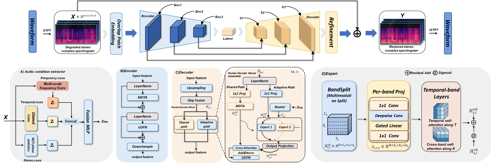

# F-MoE: Frequency-Structured Mixture of Experts for Blind Music Restoration

Official PyTorch implementation of **F-MoE**, a frequency-structured mixture-of-experts model for blind music restoration under single and compound degradations.

  

## Results

Results on the 7,000-example SonicMaster test set are shown below. KL is scaled by $10^3$.

| System | Params (M) | PQ $\uparrow$ | FAD $\downarrow$ | KL $\downarrow$ | SSIM $\uparrow$ | MM-SNR $\uparrow$ | LSD $\downarrow$ | SI-SDRi $\uparrow$ | ViSQOL $\uparrow$ |
|---|---:|---:|---:|---:|---:|---:|---:|---:|---:|
| Degraded input | - | 7.026 | 0.1107 | 5.131 | 0.777 | 5.467 | 1.141 | 0.000 | 3.833 |
| Mel-BSRNN | 5.42 | 7.260 | 0.0736 | 1.978 | 0.818 | 4.484 | 0.865 | 0.788 | 4.101 |
| MoCE | 25.35 | 7.594 | 0.0862 | 1.591 | 0.833 | 4.379 | 1.508 | -0.677 | 3.875 |
| SonicMaster (no prompt) | 1019.10 | **7.715** | 0.0734 | 1.161 | 0.605 | 4.148 | 1.155 | -0.075 | 3.777 |
| SonicMaster (generic prompt) | 1019.10 | 7.714 | 0.0732 | 1.129 | 0.606 | 4.188 | 1.154 | 0.012 | 3.781 |
| SonicMaster (oracle prompt) | 1019.10 | 7.702 | 0.0715 | **0.892** | 0.609 | 4.453 | 1.144 | 0.393 | 3.820 |
| **F-MoE** | 219.35 | 7.460 | **0.0522** | 1.112 | **0.860** | **6.317** | **0.756** | **3.466** | **4.284** |

## Preparation

### Environment

Python 3.10 or later is recommended.

~~~bash
conda create -n fmoe python=3.10
conda activate fmoe
pip install torch torchaudio --index-url https://download.pytorch.org/whl/cu124
pip install -r requirements.txt
~~~

The command above installs the CUDA 12.4 PyTorch wheels used on Linux and Windows systems with a compatible NVIDIA driver. Select the CPU or CUDA build appropriate for your system from the [official PyTorch installation guide](https://pytorch.org/get-started/locally/) when CUDA 12.4 is unavailable. The training dataset loader can use FFmpeg as a fallback decoder. The standalone inference command relies on the installed TorchAudio backend and requires that backend to support the selected input codec.

### Pretrained checkpoint

The released inference checkpoint is hosted on [Hugging Face](https://huggingface.co/Xianyyy/F-MoE). Download it with the utility script:

~~~bash
python scripts/download_checkpoint.py
~~~

The checkpoint is saved as <code>checkpoint/fmoe_5s.pth</code>. The inference entry point also accepts Lightning <code>.ckpt</code> files produced by this repository, so a newly trained model can be applied to arbitrary songs without a separate conversion step.

## Dataset preparation

F-MoE is trained on paired degraded and clean audio derived from the [SonicMaster dataset](https://huggingface.co/datasets/amaai-lab/SonicMasterDataset). The degradation taxonomy and dataset protocol follow the [SonicMaster project](https://github.com/AMAAI-Lab/SonicMaster).

Export the official Parquet release into the paired layout. The default command downloads the complete Parquet dataset snapshot, so make sure sufficient disk space and bandwidth are available. If the snapshot is already present locally, use `--parquet-dir` to avoid downloading it again:

~~~bash
python scripts/prepare_sonicmaster.py --output-dir data
~~~

For a local dataset snapshot:

~~~bash
python scripts/prepare_sonicmaster.py 
  --parquet-dir path/to/SonicMasterDataset 
  --output-dir data
~~~

The exporter validates row identifiers, required metadata, duplicate records, clean-target consistency, and non-empty audio payloads. It creates the metadata manifest and paired audio files under <code>data/</code>. The training preflight separately checks split/pair consistency and audio headers before training. The downloaded Parquet snapshot remains under <code>data/raw/sonicmaster/</code> after export; remove it only after verifying the exported pairs and metadata if you need to reclaim disk space.

If the dataset is stored elsewhere, update the corresponding paths in <code>configs/fmoe_train.yaml</code>:

~~~yaml
audio_data_dir: data/pairs
degradation_metadata_jsonl: data/metadata.jsonl
ckpt_dir: checkpoints
~~~

Dataset licensing and source-recording attribution details are provided in [DATASET_ATTRIBUTION.md](DATASET_ATTRIBUTION.md).

## Main entry points

The repository exposes three primary workflow entry points:

| Entry point | Responsibility |
|---|---|
| <code>train.py</code> | Non-overlapping 5-second training and checkpoint resumption |
| <code>inference.py</code> | Single-file and folder-based audio restoration |
| <code>evaluate.py</code> | Paired test-set evaluation, metric computation, and result validation |

Internal modules under <code>src/</code> and <code>evaluation/</code> implement these workflows; they are not separate public launch commands.

### Training

Start the released training recipe:

~~~bash
python train.py --config configs/fmoe_train.yaml
~~~

Resume a compatible checkpoint from the same run:

~~~bash
python train.py --config configs/fmoe_train.yaml 
  --resume_from checkpoints/fmoe_5s/last.ckpt
~~~

Training artifacts are written under the configured checkpoint directory. The run folder contains validation-selected checkpoints, the latest resumable checkpoint, and experiment metadata. 

### Inference

Restore a single audio file:

~~~bash
python inference.py 
  --input path/to/input.wav 
  --checkpoint checkpoint/fmoe_5s.pth
~~~

Restore every supported audio file in a folder:

~~~bash
python inference.py 
  --input path/to/audio_folder 
  --checkpoint checkpoint/fmoe_5s.pth
~~~

Restored files are written to <code>inference_results/</code> by default. WAV and FLAC are recommended; MP3, OGG, and M4A require a TorchAudio backend with the corresponding codec support.

Inference follows the released audio frontend and uses overlapping chunks with cross-fading to reduce boundary artifacts.

### Evaluation

The evaluation interface centralizes the paired SonicMaster test runner and the reproducible metric tools.

#### Paired SonicMaster test split

Evaluate a trained Lightning checkpoint against the paired SonicMaster test split. The runner selects CUDA when available and falls back to CPU:

~~~bash
python evaluate.py sonicmaster 
  --config configs/fmoe_train.yaml 
  --checkpoint_path path/to/best.ckpt 
  --save_results
~~~

This runner evaluates the paired test data and can save restored, degraded, and clean audio. Its local PESQ, LSD, SiSPNR, and SiSNR outputs are supplementary diagnostics; PESQ requires the optional `pesq` package and is reported unavailable when that package is not installed. These diagnostics should not be confused with the separate perceptual-metric and signal-metric evaluation pipelines below.

#### Manifest-based evaluation

For comparisons across F-MoE and other restoration systems, prepare a JSONL manifest with one entry per test item:

~~~json
{"id":"song001_deg1","original_location":"audio/clean/song001.wav","location":"audio/degraded/song001_deg1.wav","degradations":["compression"]}
~~~

Prepare the evaluation directory and register prediction folders:

~~~bash
python evaluate.py prepare 
  --manifest path/to/manifest.jsonl 
  --root evaluation_runs/paper_test 
  --prediction fmoe=path/to/fmoe_predictions
~~~

Prediction files must be named by manifest ID and use WAV or FLAC. Audio is referenced in place rather than copied.

Run the supplementary signal metrics. Evaluate the degraded input first so SI-SDRi uses a frozen paired baseline:

~~~bash
python evaluate.py signal 
  --root evaluation_runs/paper_test 
  --models degraded_input 
  --device auto

python evaluate.py signal 
  --root evaluation_runs/paper_test 
  --models fmoe 
  --device auto
~~~

ViSQOL is optional and requires the official [Google ViSQOL](https://github.com/google/visqol) package:

~~~bash
python evaluate.py visqol 
  --root evaluation_runs/paper_test 
  --models degraded_input fmoe
~~~

Merge and validate the signal-metric results:

~~~bash
python evaluate.py merge --root evaluation_runs/paper_test
python evaluate.py validate --root evaluation_runs/paper_test
~~~

The repository also provides the perceptual metric family associated with SonicMaster's global evaluation: FAD on CLAP embeddings, KL divergence, log-mel SSIM, and Production Quality (PQ). These runners are kept separate from the supplementary signal metrics above.

Install the additional dependencies:

~~~bash
pip install -r evaluation/requirements-model-metrics.txt
~~~

Run KL divergence and log-mel SSIM:

~~~bash
python evaluate.py kl-ssim 
  --root evaluation_runs/paper_test 
  --models degraded_input fmoe
~~~

Run FAD with the released CLAP checkpoint:

~~~bash
python evaluate.py fad 
  --root evaluation_runs/paper_test 
  --models degraded_input fmoe 
  --clap-checkpoint path/to/630k-audioset-best.pt
~~~

Run PQ with the Audiobox Aesthetics checkpoint:

~~~bash
python evaluate.py pq 
  --root evaluation_runs/paper_test 
  --models degraded_input fmoe 
  --audiobox-checkpoint path/to/audiobox_aesthetics/checkpoint.pt
~~~

Use the same CLAP and Audiobox Aesthetics checkpoints and evaluation settings for every compared system. Follow the upstream [Audiobox Aesthetics](https://github.com/facebookresearch/audiobox-aesthetics) installation instructions.

## Verification

Check the numerical equivalence of the supplementary LSD and SI-SDRi kernels against the archived public reference implementations:

~~~bash
python evaluate.py verify-kernels
~~~

Run the repository tests:

~~~bash
pytest -q
~~~

## Architecture

F-MoE uses a hierarchical complex-spectral encoder-decoder. An audio-derived degradation encoder summarizes frequency, temporal, and stereo cues into one global condition vector, `z_deg`. Every routed decoder block selects its Top-1 frequency-structured expert only from a block-specific linear projection of this shared `z_deg`; the expert-selection bias is shared within each decoder stage. Local decoder features are processed by the selected expert but do not determine the routing decision. Shared attention features and cross-attention provide the decoder fusion path.

The network accepts stereo complex spectrograms in the channel order **Re(L), Im(L), Re(R), Im(R)** and predicts a complex-spectral residual.

## Repository layout

~~~text
F-MoE/
├── assets/
├── configs/
├── evaluation/
│   ├── metric_sources/
│   │   └── README.md
│   ├── prepare_protocol.py
│   ├── run_audio_metrics.py
│   ├── run_model_metrics.py
│   ├── verify_metric_kernels.py
│   ├── metric_kernel_equivalence.json
│   ├── __init__.py
│   └── requirements-model-metrics.txt
├── scripts/
│   ├── download_checkpoint.py
│   └── prepare_sonicmaster.py
├── src/
│   ├── data/
│   ├── deg/
│   ├── net/
│   ├── utils/
│   ├── __init__.py
│   ├── augment.py
│   ├── options.py
│   ├── evaluate_sonicmaster.py
│   └── train_core.py
├── evaluate.py
├── inference.py
├── train.py
├── pytest.ini
├── tests/
├── dataset.md
├── LICENSE
└── requirements.txt
~~~

## Acknowledgements

The training and evaluation data are derived from the [SonicMaster dataset](https://huggingface.co/datasets/amaai-lab/SonicMasterDataset), and the degradation taxonomy and evaluation setup follow the [SonicMaster project](https://github.com/AMAAI-Lab/SonicMaster).

F-MoE builds upon ideas and implementations from [Restormer](https://github.com/swz30/Restormer) and [MoCE-IR](https://github.com/eduardzamfir/MoCE-IR). Its frequency-structured experts are informed by prior work on [Band-Split RNN](https://doi.org/10.1109/TASLP.2023.3271145) and [Band-Split RoPE Transformer](https://arxiv.org/abs/2309.02612). We use [Audiobox Aesthetics](https://github.com/facebookresearch/audiobox-aesthetics) for reference-free Production Quality evaluation. We thank the authors and contributors of these projects.

## License

This repository is released for academic, non-commercial research under the [CC BY-NC-SA 4.0 License](LICENSE). Third-party components retain their original copyright notices and license terms.
